# Alza — Plans that rise to 3D

A floor plan is coordinates, not buttons — which is why an agent cannot use one by
pretending to be a mouse. So Alza does not make it try. It hands over the model itself: the
full metric geometry, published as typed tools through **WebMCP**, on the same live page a
person is drawing on.

You draw walls, rooms, doors, windows and furniture in a precise 2D editor, or load a photo
of a plan and trace over it. Your agent works that same model with the same tools — it
checks its own work against a constraint engine, buys furniture from a second origin, and
raises the result into a 3D model you can walk through. Built for the
[WebMCP Challenge](https://webmcp.devpost.com/).

Everything runs client side. No backend, no accounts, plans stay on your machine.

---

## The two-minute film

<p align="center">
  <a href="https://www.youtube.com/watch?v=RihMFcMstvI">
    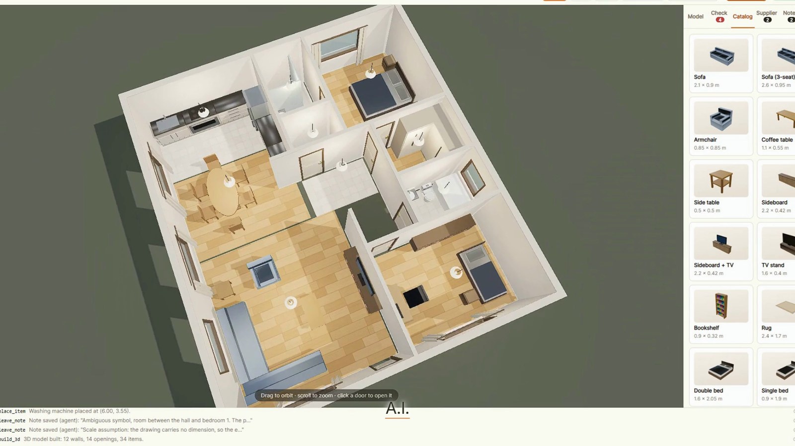
  </a>
</p>

<p align="center"><em>2 min 15 s. The agent gets a photo of a plan, asks for one real
dimension, and draws the whole thing. After that it checks itself, buys a chair from another
origin, gets a destructive call refused by a human, and walks the result.</em></p>

I put the film together with [HyperFrames](https://hyperframes.heygen.com/) from a
storyboard, a script and HTML compositions. That authoring tree is not carried here; the
finished film is on YouTube and its stills are in [`shots/showcase/`](shots/showcase/).

What *is* here is the part you need to reproduce what the film shows:
[`scripts/trace.mjs`](scripts/trace.mjs) holds the demo plan as data, and [`scripts/record6.mjs`](scripts/record6.mjs)
drives the real app through the eight beats while ffmpeg captures the screen at 60 fps.

## What it looks like

The plan below was traced by the agent from a photo of a drawing it had never seen. Every
coordinate came out of tool calls. Nothing was placed by hand.

<p align="center">
  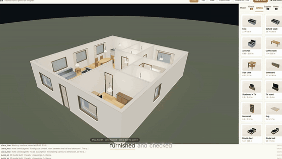
</p>

<p align="center">
  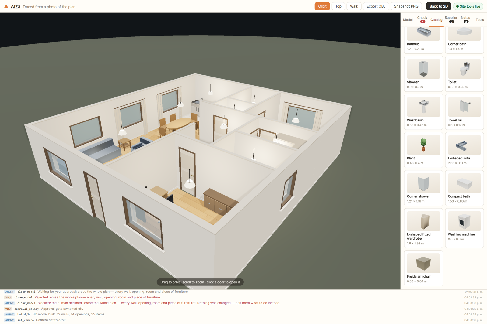
</p>

The proof in one image. The drawing underneath is the source photo; the dark geometry on top
is what Alza built from it. The agent asked for a single real dimension, set the scale from
that, and traced the rest.

<p align="center">
  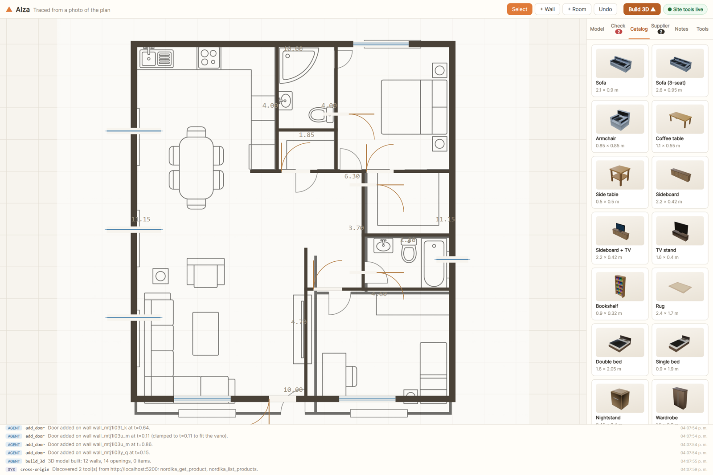
</p>

| | |
|:--:|:--:|
| 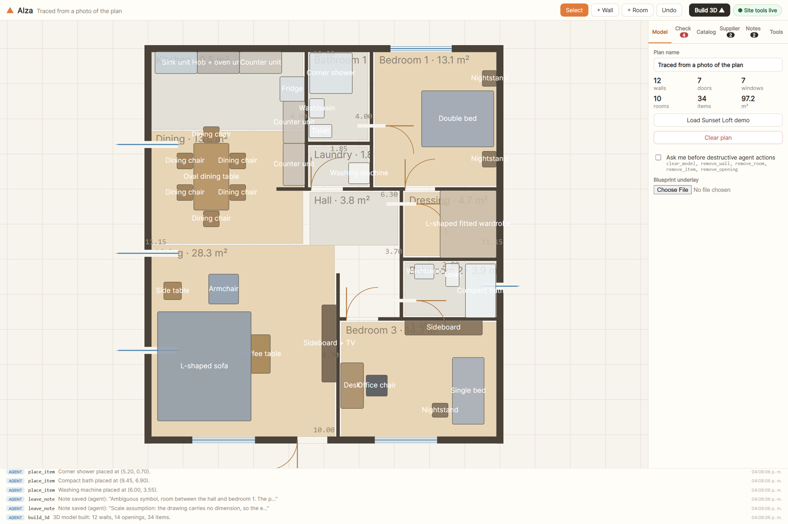 | 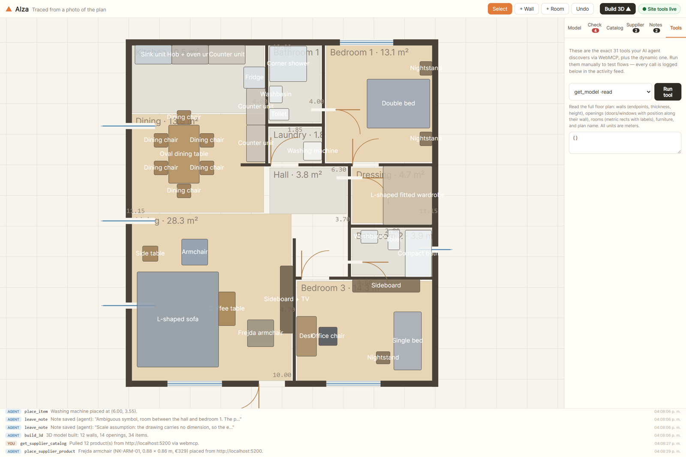 |
| The finished plan: 12 walls, 14 openings, 10 rooms, 34 pieces, with live areas per room. | The tools, published by the page itself. No server and no key, just `document.modelContext.registerTool`. |
| 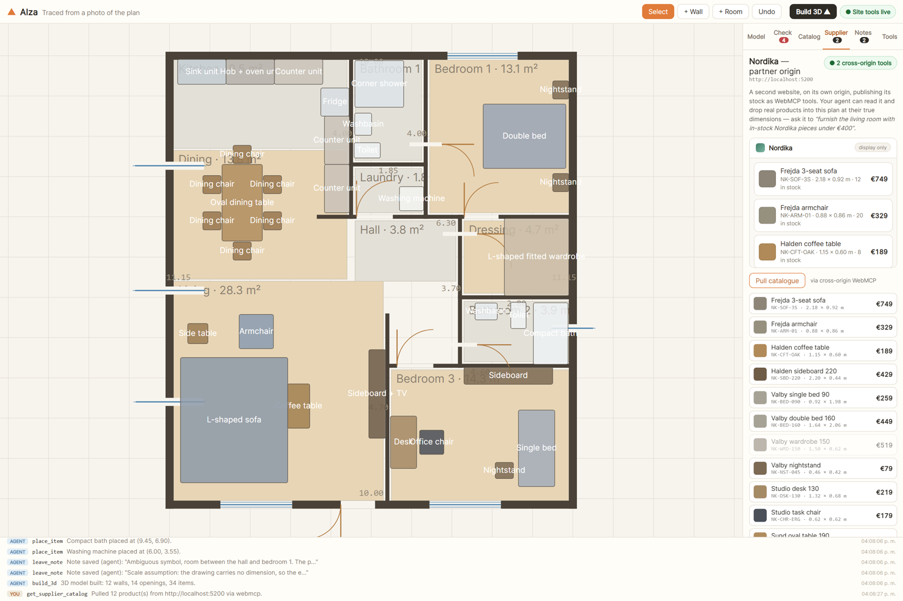 |  |
| A furniture shop on its own origin publishes its own tools and shares them with this page. | One instruction crosses that boundary, and a real product lands in the plan at its real size. |
| 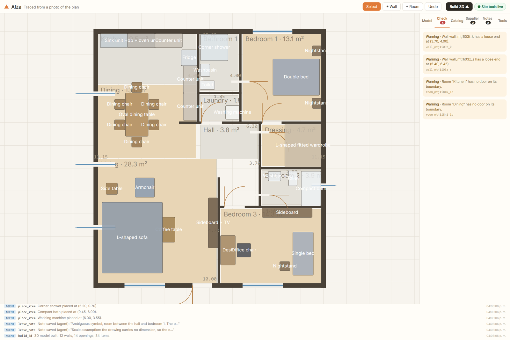 | 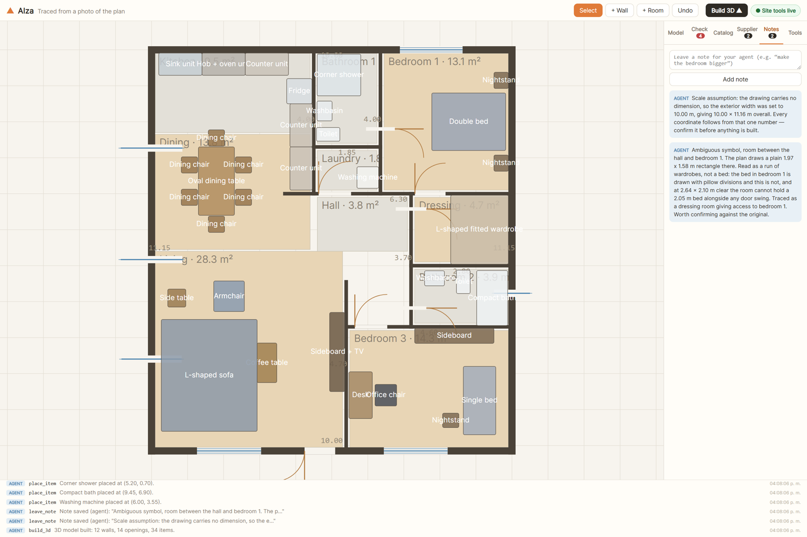 |
| It checks its own work: overlaps, wall crossings and blocked door swings, reported in metres. | When it cannot know something, it says so. Here it flags an ambiguous symbol and its scale assumption. |
| 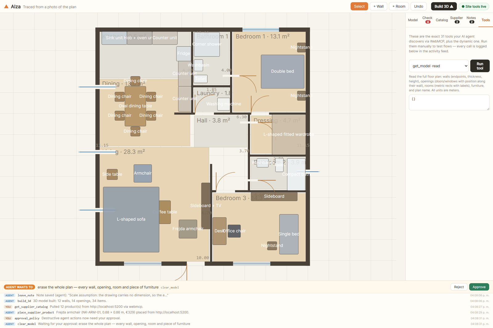 | 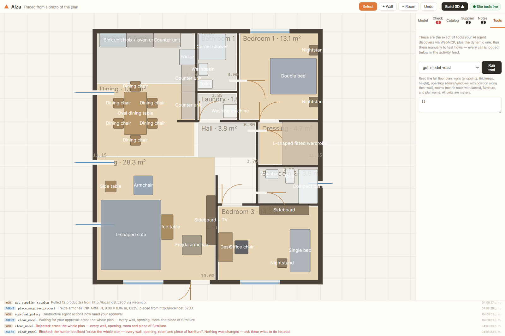 |
| The human keeps the veto: a destructive call parks on the page until a person decides. | The refusal comes back as words the agent can act on, not a silent failure. |
| 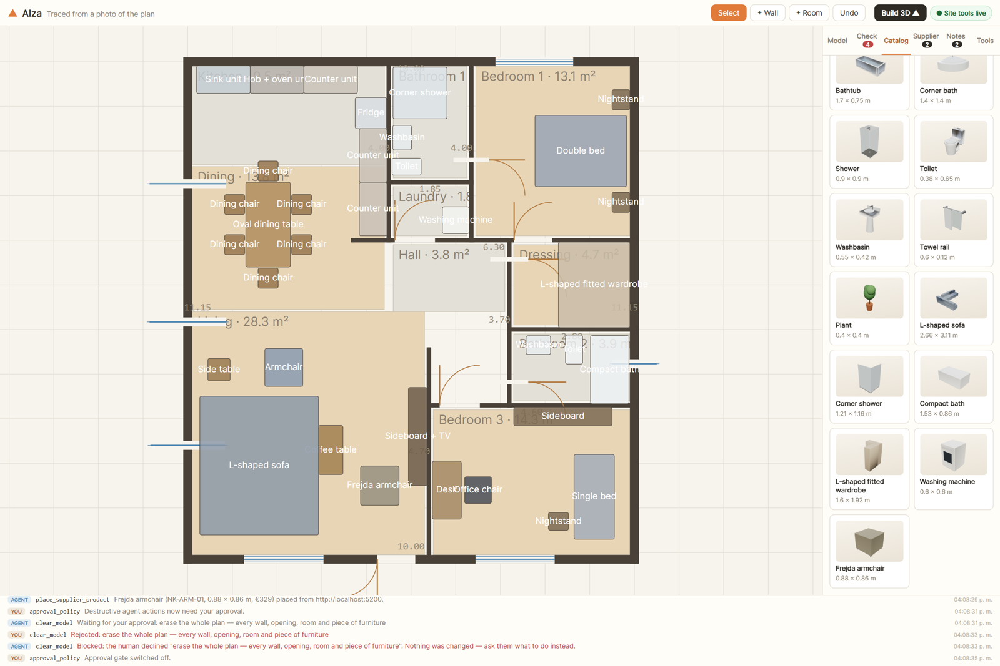 | 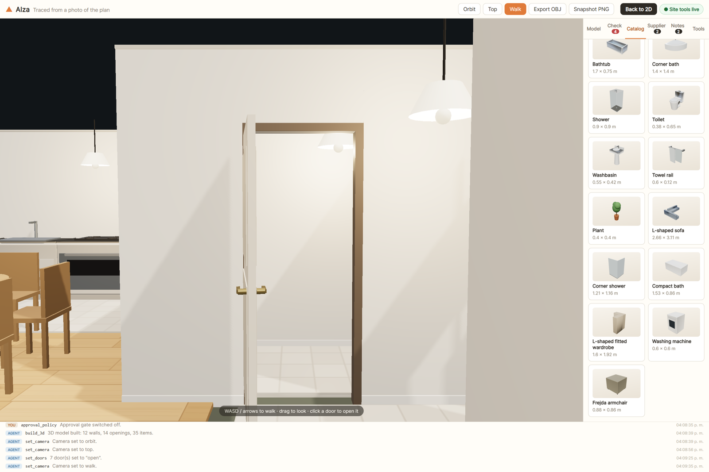 |
| When the catalogue has no honest match, the agent models the piece itself: an L-shaped sofa, a corner shower, a compact bath, a fitted L wardrobe, a washing machine. | Then you walk it, at 1.6 m eye height, doors open, collision on. |

More stills in [`shots/showcase/`](shots/showcase/).

## Try it in 2 minutes

1. Open the live app (link at the top of this repo).
2. **In ChatGPT desktop:** open the URL in the in-app browser. WebMCP works out of the box.
   **In Google Chrome 149+:** enable `chrome://flags/#enable-webmcp-testing` and restart.
   The agent status in the top bar turns green: **Agent tools on** (43 tools registered).
3. Ask your agent, for example:
   - *"Add a 3 × 2.5 m study next to the bedroom, with a door and a window."*
   - *"The sofa placement feels off. Check the plan and fix any issues."*
   - *"Build the 3D and give me a walkthrough."*
4. No WebMCP runtime? The app is still complete. Open **Activity → Developer tools** in the side
   panel and run the exact same 44 tools manually; every call is logged in Activity.

## Trace your own plan with the agent

Have a floor-plan image (scan, photo, PDF export)? Let the agent rebuild it in 3D:

1. Upload the image in **Properties → Blueprint underlay** (it appears on the 2D
   canvas), and attach the same image in the chat so the agent can see it.
2. Give the agent **one real dimension** from the plan, e.g. *"this wall is 4.6 m"*.
   It calls `calibrate_underlay` with two points on the image and that distance, and the
   blueprint is scaled to true meters.
3. Ask: *"Trace this plan: walls, doors, windows, rooms, then furnish it and check for
   issues."* The agent draws over the underlay with `add_wall` / `add_door` / `add_window`,
   verifies with `measure` + `get_issues`, fixes what it got wrong, and finishes with
   `build_3d`.
4. Correct anything by hand. You and the agent share the same model.

## Why WebMCP is the point

Canvas geometry is exactly where agent actuation falls over. You cannot click-and-drag a
wall reliably, and there is no DOM to scrape. So Alza publishes the plan as **structured
tools** via `document.modelContext.registerTool`, and those tools call the same store
actions the UI buttons call. Human and agent end up co-editing one model on one live page.

```js
document.modelContext.registerTool({
  name: "add_wall",
  description: "Add a wall segment from (ax,ay) to (bx,by) in meters…",
  inputSchema: { /* … */ },
  execute: async (input) => { /* the same action the + Wall button uses */ },
});
```

## The 43 tools (+ 1 dynamic)

| Group | Tools |
|---|---|
| **Read** (readOnly) | `get_model` · `get_issues` · `get_item_catalog` · `get_editor_state` · `measure` · `get_underlay` |
| **Blueprint** | `calibrate_underlay`, scales the uploaded plan image to real meters from one known dimension |
| **Structure** | `add_wall` · `edit_wall` · `remove_wall`; a wall may be curved: `curve` takes a bulge, a sagitta (how far its middle stands off its chord) or a point it passes, and `edit_wall` bends or straightens it |
| **Openings** | `add_door` · `add_window` · `move_opening` · `remove_opening` · `set_door_swing` (hinge side + swing direction) |
| **Rooms** | `add_room` · `update_room` · `remove_room`; a room is a rectangle (`x`, `y`, `w`, `h`), an outline of 3 to 100 `points` with `arcs` on any edge (by sagitta out of the room, or a point the arc passes), or `fit` (the outline the walls close off round a point, to their inner faces). An agent reshapes a room by giving `update_room` its whole outline |
| **Furniture** | `place_item` · `move_item` · `remove_item` · `define_item_kind`, model a piece the catalogue lacks, from primitives |
| **Levels & stairs** | `list_levels` · `add_level` · `update_level` (rename, floor-to-floor height — the walls that met the slab follow it unless `walls: "keep"` — or its place in the stack) · `remove_level` (needs approval) · `set_active_level` · `add_stair` (straight or L-shaped; risers and going derived from the storey height) · `update_stair` · `remove_stair` (needs approval) |
| **Model & view** | `set_plan_name` · `clear_model` · `build_3d` · `set_camera` (orbit/top/walk) · `set_3d_style` (ink edges, dollhouse cutaway at a height) · `set_doors` (swing the leaves open/shut) |
| **Export** | `export_ifc`, writes the whole plan as an IFC4 building model and downloads it for the human, who approves every export first, whatever the approval policy (a file on their machine is not something undo can take back); the agent gets the file's summary (schema, size, entities by type), not the file |
| **Cross-origin** | `get_supplier_catalog` · `place_supplier_product`, read a **partner origin's** own WebMCP tools and drop its real products into the plan |
| **Collaboration** | `leave_note` · `get_notes` |
| **Shared session** | `get_presence`, what the person is doing right now: level, view, selection, what they are dragging, their pointer and the plan area on their screen (unless they switched sharing off), and the other tabs on the plan · `point_at`, a marker with a short message on a wall, room, piece or stair, in the plan and in 3D |
| **Dynamic** | `extend_selected_wall`, published **only while the human has a wall selected** (registered/unregistered live, per the spec's `toolchange` cycle). The human points, the agent acts on exactly that wall. |

`get_model`, `get_issues`, `add_wall`, `edit_wall`, `add_room`, `update_room`, `place_item`,
`move_item` and `place_supplier_product` also take an optional `level` (a level's id or its
name, which no other level shares): without it they read or draw on the level the human is
working on.

A few design notes:

- One store, two users. A vanilla zustand store powers both the React UI and the WebMCP
  tools, so actions, validation and undo history are identical for both.
- Every tool call, human or agent, is logged to an on-page activity feed with source
  badges. The spec asks that tools run visibly on the page; this is that.
- `readOnlyHint` / `untrustedContentHint` annotations help the agent plan, and every tool
  carries a `title` next to its `name`. MCP's `destructiveHint` rides along too — WebMCP
  does not define it yet, so it is enforced page-side (see the spec notes below).
- Tools are registered with `registerTool(descriptor, { signal, exposedTo })` and retired
  by **aborting that signal**, which is the spec's unregistration path and what makes the
  runtime emit `toolchange`.
- `get_issues` runs a geometry constraint engine (below). Agents call it after editing
  and fix their own mistakes, which is the self-repair loop.
- Without a WebMCP runtime the app loses nothing. **Activity → Developer tools** runs the
  same tools by hand.

## Two things WebMCP makes possible that I had not seen elsewhere

### 1. The human approves what the agent destroys

The explainer lists per-call user confirmation as an **open question** ("a way for a tool
to prompt the user for confirmation"). Alza answers it on the page. A tool annotated
`destructiveHint` does not run when the agent calls it; it becomes a **request card** on
the plan, beside the thing it would remove (*"Your agent wants to clear the whole plan"*),
with that target hatched in red and the request listed under **Waiting for you** in
Activity. The agent's `execute()` stays pending until a human keeps the plan (Esc) or
confirms (Ctrl+Enter). Reject returns a real
failure the agent can act on ("the human declined … ask them what to do instead"), and the
`AbortSignal` WebMCP passes to `execute()` releases the request if the agent gives up
first.

The gate is a switch in **Properties** (with nothing selected), and the policy is stated in
words under the queue in Activity, with a Change link to the same switch. It also guards
**Developer tools**, because both paths run through the same wrapper.

### 2. One agent, two origins, one plan

**Nordika** is a separate website on its own origin (`partner/`). It knows nothing about
Alza. It publishes its stock as its own WebMCP tools (`nordika_list_products`,
`nordika_get_product`) and shares them with the studio using
`registerTool(descriptor, { exposedTo })`.

Alza embeds it in an iframe carrying **`allow="tools"`** (the `tools` Permissions Policy),
discovers those tools with **`getTools({ fromOrigins })`** and calls them with
**`executeTool()`**. So an agent standing on one page composes two origins: it reads a
supplier's real catalogue and lays those products into the plan at their true dimensions,
where the constraint engine judges them like anything else. *"Furnish the living room with
in-stock Nordika pieces under €400"* is a single instruction that crosses a security
boundary with no server in the middle. The browser is the integration layer.

Where a runtime has no cross-origin support, the same two calls run over `postMessage`,
and the UI says which transport was used.

## The constraint engine (`get_issues`)

Metric precision is the product. The checker validates:

- **Walls:** too short, loose ends (T-junctions count as connected), collinear overlaps
  (total or partial), mid-span crossings.
- **Openings:** vano fully inside its wall (creation-time clamping + detection), overlapping
  openings, sill + height above wall height, and **a wall ending inside another wall's
  opening**.
- **Rooms:** floating, overlapping (by their real outlines), doorless, too small, and an
  outline that crosses itself, has an edge under 5 cm or bends past a half circle.
- **Curved walls:** an arc tighter than the wall's thickness allows, and an opening too wide
  for the straight leaf or pane across its chord to stay inside the wall.
- **Doors:** two doors whose leaves swing into each other.
- **Furniture:** oriented-rectangle **SAT** against walls (leaning is legal, crossing is an
  error), blocking door swing paths and window light (with a sill-height nuance),
  item-vs-item collisions (rugs exempt), items outside every room.
- **Storeys and stairs** (checked level by level, so walls on different floors are never
  compared): a wall under a level above that stops short of its slab or runs up through it, a
  stair with no level above, risers or goings out of range, the 2R + G comfort rule, headroom
  under the slab, a wall in the stair or over its stairwell, a blocked landing at either end,
  a stairwell outside every room, furniture on a stair or over a stairwell, overlapping stairs.

The bundled **Sunset Loft** demo is audited to **0 issues** and kept that way by a
regression test, as is **Crescent House** (Plan menu), the free-shapes demo: two storeys with a
curved facade on both, a wing turned off the house at an angle under a roof terrace, an
L-shaped kitchen round a pantry, and a stair.

## Storeys, stairs and the plan format

A plan is a stack of **levels**, listed from the ground up, each with its floor-to-floor
height; every wall, room, piece and stair names the level it stands on, and where each floor
stands follows from the heights below it. The 2D plan shows one level at a time over a ghost
of the one below (PageUp / PageDown or the level switcher change it); the 3D view stacks the
storeys on their slabs, opens a stairwell over every stair and lets the walker climb it. A
stair stores only where it starts, which way it climbs, its width and shape; its risers,
going, landing and clear zones are worked out from the storey height, the same way for the
plan, the model, the walker and the checker.

Plans are saved in **format 3** (`version: 3`, `model/planFormat.ts`), where a room is its
outline (`points`, each corner carrying the bulge of the edge it starts) and a wall may carry a
`bulge` and be an arc. Older plans load losslessly: a format-2 room's rectangle becomes its four
corners and every wall stays straight (no bulge), and a format-1 plan (one storey, no levels)
first becomes a single "Ground floor" holding everything. A bow too slight to be an arc (its
middle under 0.01 mm off its chord, the IFC export's precision) is stored straight. A plan from
a newer format, or one that names a level it does not have, is refused and the current plan
stays.
Every plan has an `id` of its own, 128 random bits given when it is started (a demo loaded, a
plan cleared); a plan saved without one is given one as it loads, and keeps it from then on.

## Export to CAD and BIM (IFC)

**Export → Building model (IFC)**, or the `export_ifc` tool, writes the whole plan, every level,
as an **IFC4** file (ISO 10303-21 STEP, schema `IFC4`, view definition
`DesignTransferView_V1.0`), so it opens in CAD and BIM tools as a building rather than a mesh.
It is written from the plan, not from the 3D view, so it works from either view; nothing leaves
the browser, and the writer is fetched the first time someone exports (a lazy chunk of about
20 kB, 7.5 kB gzipped), never with the page.

| In the plan | In the IFC file |
|---|---|
| the plan | `IfcProject` (metres, radians; a 3D *Model* context with *Body* and *Axis*, a 2D *Plan* context with *FootPrint*) › `IfcSite` › `IfcBuilding`, named after the plan |
| each level | `IfcBuildingStorey`, with its name and elevation, standing on one `IfcSlab` `FLOOR` of plaster: under its rooms and its walls to their joints (the outline the 3D view builds its slab from, so there is no gap under any wall at a floor line), opened by an `IfcOpeningElement` wherever a stair from below rises through it; `Qto_SlabBaseQuantities` |
| a wall | `IfcWall` (`STANDARD`): an *Axis* (a line, or for a curved wall an `IfcIndexedPolyCurve` arc through its ends and middle) and a *Body* extruded from its outline (a rectangle, or its two faces as arcs concentric with the centreline), butt-jointed to the walls it meets at any angle, its ends cut along the face they meet, a curved face included (at a corner the wall whose id sorts first runs on to the other's outer face and the other stops at its inner face; a wall ending against another stops at its face; walls in line meet end to end), so no two bodies overlap; one `IfcMaterialLayerSetUsage` of plaster its thickness, `Pset_WallCommon.IsExternal` where the rooms tell (a room on one side only), `Qto_WallBaseQuantities` measured on the body |
| a door / window | an `IfcOpeningElement` voiding its wall (on a curved wall, the stretch between two cuts square to the arc, placed on its chord's middle), reaching past every wall face it cuts (both sides, and the foot or top where it meets them), filled by an `IfcDoor` or `IfcWindow` with its overall width and height. A door's placement faces the side its leaf swings to (IFC opens a door towards its +Y) and its `OperationType` names the hinge side seen that way, so all four hinge/side combinations come out as the plan draws them |
| a room | an `IfcSpace` under its storey (`LongName` = the room's name), its *FootPrint* and *Body* its real outline (an `IfcPolyline`, or an `IfcIndexedPolyCurve` of `IfcLineIndex` and `IfcArcIndex` segments where it has arcs), with `Pset_SpaceCommon` and `Qto_SpaceBaseQuantities`, and its floor finish as an `IfcCovering` `FLOORING` laid on the slab (4 cm, less any stairwell), covering the space (`IfcRelCoversSpaces`), in the finish's `IfcMaterial`, with `Qto_CoveringBaseQuantities` |
| a stair | `IfcStair` (straight run or quarter turn) made of `IfcStairFlight`s with their risers, treads, riser height and going, and, for an L-shaped one, its landing as an `IfcSlab` `LANDING`; `Pset_StairCommon` |
| a piece of furniture | `IfcFurniture` named from the catalogue, its kind in `ObjectType`, standing on the floor finish; a Nordika product carries its sku and vendor in `Alza_Product`, the plan's own property set (the `Pset_` and `Qto_` prefixes are buildingSMART's, for the sets IFC4 defines) |

Every element stands in its storey (`IfcRelContainedInSpatialStructure`) and is placed relative
to it. GlobalIds are derived from the plan's id together with each element's own, so exporting
the same plan again gives every element the same GlobalId and a tool that re-imports it updates
rather than duplicates, while two different plans never share one. Every name is written as a
clean label of at most 255 characters (`IfcLabel` and `IfcIdentifier` are `STRING(255)`): control
characters and invisible formatting characters (bidirectional overrides and isolates, zero-width
spaces) are taken out of plan text, a partner's product names and loaded ids included, then
encoded in STEP's `\X2\` form where they are not plain ASCII (*Habitación*, *Baño*). The file
name is the plan's name made safe the same way, with the characters file systems reserve
replaced and capped at the plan name's 120 characters; the OBJ and PNG exports share it.

A plan that holds a number outside the range the editor keeps it to (a wall 0 m thick, a room
3 km off: a plan loaded as data is checked for its shape, not its ranges) is not exported: the
menu and `export_ifc` answer with the values to fix, and no file is written. The writer itself
also refuses a length IFC requires to be positive that is not, and a label past 255 characters,
rather than writing a file a reader would reject; reals too large for fixed notation are
written in STEP's exponent form (`1.E22`).

What is simplified: walls, slabs, openings and furniture are extruded solids (furniture is its
catalogue footprint and height, not its 3D model); walls are butt-jointed by their bodies, not
connected with `IfcRelConnectsPathElements`; the ground floor stands on a slab like the floors
above it; a stair's flights are stacked solid treads, and the floor finish runs under a stair as
it does in the 3D view; there is no site geometry, roof, ceiling or owner history (optional in
IFC4); `LoadBearing` is never stated because the plan does not know it; and supplier prices are
not in the file, because the plan does not keep them.

The tests read every exported file back with a STEP reader and an IFC4 checker written apart
from the exporter (`tests/support/ifcCheck.ts`): syntax and escapes, every `#` reference and the
kind of entity each may point to, the attribute count of every entity against IFC4 ADD2 TC1,
required attributes, enumeration values, reals written as reals, positive lengths, labels within
`STRING(255)`, property sets under buildingSMART's prefixes being standard ones, unique and valid
GlobalIds, one storey per element, every opening voiding one element and every door or window
filling one opening, and every placement chaining to its storey's. Beyond the checker, they
rebuild the solids from the file and probe them: no two wall bodies overlap and every joint is
filled once, the floor line under every wall is closed, every void passes the faces it cuts, and
every door's placement and `OperationType` swing it and hang it as the plan does.

## A shared session: the person, the agent and every tab on one plan

The person and the agent work the same plan at the same time, and each sees the other move.

- **The agent is seen at work.** While a tool call runs, a marker in the agent's colour glides to
  what it touches, the entity gets a soft highlight, and a label says what it does ("Agent ·
  moving Sofa"), on the plan and over the 3D model. Nothing in the tools does this: it follows
  from `dispatch()` and the tool runner, so every tool, present and future, is seen. The activity
  feed stays the record of what was done.
- **The agent sees the person.** `get_presence` answers the person's level, view, selection, the
  entity under their pointer, the plan area on their screen and whether they are dragging
  something. The person can switch off sharing their pointer and view (the presence indicator
  in the top bar, kept per browser and followed by every open tab at once). `point_at` lets the
  agent show the person what it means; its message is also said through a polite live region
  and kept in the activity feed.
- **No edit under the hand.** While the person drags, nudges or types into something, an agent's
  change to that same thing is refused with `conflict.code: "person_editing"` and
  `retryAfterMs`: nothing changes, and the agent calls again once the hand lets go. Refused, not
  queued, so a call never hangs on a hand that does not let go. Until then the page shows
  "Agent · waiting for you". What a hand holds reaches the other tabs before the drag's first
  frame does, so an agent in another tab is refused from that frame on.
- **Tabs of one browser.** Two tabs with the studio open share one plan over a `BroadcastChannel`
  (same origin only). A tab that opens later takes up the plan the others hold, once, keeping
  whatever was changed in it before it joined. A change travels as entity writes stamped with a
  Lamport clock; the last writer wins, per entity, so every tab ends on the same plan whatever
  order the writes arrive in (past a plan's limits, such as its notes, the newest are kept the
  same way everywhere). Another tab's change lands through `dispatch()` as one feed line
  ("Another tab"), a whole drag as one. Undo stays local: it takes back the tab's own changes,
  never another tab's, because each of its steps is rebased under the changes the other tabs
  make. Every message is checked against a zod schema, and anything malformed or foreign is
  ignored, and so is a message in another version of the format (`SESSION.protocol`, 2 since
  rooms became outlines and walls arcs): a tab still running an older build does not exchange
  changes with this one until it is reloaded. Each tab shows the others' pointers, named "Tab 2"
  and so on, in colours that follow the light and dark themes.

There is no server: the session lives in the browser. `src/session/transport.ts` is the seam
where a network relay could carry the same messages between machines.

## Architecture

```
src/
  model/    types.ts · geometry.ts (snap, SAT, segment math) · issues.ts (checker rules)
            catalog.ts (32 built-in kinds + the plan's own kinds) · resolve.ts (id/name lookup)
            store.ts (shared actions, undo, activity) · commands.ts (dispatch: the one change path)
            assets.ts (underlay images, kept while the plan or its undo history names them)
            sceneBus.ts · seed.ts · demoCrescent.ts (the free-shapes demo; loaded when chosen)
            provenance.ts (what each change touched; its revision number)
            levels.ts (storeys: elevations, what stands on each, stairwells, level names)
            stairs.ts (a stair's whole shape — risers, treads, landing, walking line, clear
            zones, headroom, the guard round its stairwell — from the little the plan stores)
            planFormat.ts (the save format, version 3, and the migration of format-1 and -2 plans)
            shapes.ts (arcs by their bulge and outlines with arc edges: length, point and
            tangent at t, where curves meet, winding, self-crossing, the label's anchor)
            enclose.ts (a room fitted to the walls round a point; loaded when asked for)
            joints.ts (a wall's footprint mitred against the walls it meets at any angle, for the
            plan's poché, the floors and the 3D view, and the IFC export's butt joints) · floors.ts (what a storey's slab covers, for the 3D view
            and IFC alike) · region.ts (flat regions with holes, cut into trapezoids)
            text.ts (plan text made a clean name) · planRanges.ts (every number held to its range,
            for what writes a plan out) · ids.ts (entity ids, and a plan's own random id)
            presence.ts (who is on the plan and where: never saved, never in undo)
            touch.ts (what a command touches) · places.ts (where an entity is, by id)
  export/   download.ts (every export's file name and download) · ifcExport.ts (the IFC export's
            one path, menu and tool alike; fetches the writer on first use)
            ifc/ (loaded on demand) step.ts (ISO 10303-21 encoding) · guid.ts (stable GlobalIds)
            entities.ts (the IFC4 entities written, attributes in schema order) · model.ts (the
            plan mapped to them) · config.ts · index.ts
  editor/   Editor.tsx — SVG drawing sheet: poché walls, chained walls (Shift keeps them
            straight, ends snap to ends), rooms, doors (D) and windows (N) placed on a wall,
            plan symbols for furniture, dimension chains, numbered revision marks for the
            agent's changes, 5 cm snap, arrow-key nudge, pan (H, Space-drag) and zoom (+, -,
            Shift+1 fits) · canvasState.ts (the view and the editor's own tools)
            drawing.ts · symbols.tsx · stairSymbol.ts (a stair's plan symbol: treads and
            edges below the cut, hidden past it, the break line, UP/DN, the stairwell's guard)
            StairDrawing.tsx (that symbol drawn; loaded after the first paint)
            roomDraft.ts (the room tool's outline, corner by corner, from the pointer or the
            keyboard's cross) · ShapeHandles.tsx (corner and edge handles, bending a wall) and
            WallPoche.tsx (each wall's mitred footprint; a parapet below the cut in outline),
            both loaded after the first paint
  three/    (loaded on demand: the 2D editor's first chunk has no three.js)
            build.ts (extrusion with real openings, resolved joints, floors) · wallSolids.ts
            (walls extruded from their footprints, cut square to the arc at their openings)
            triangulate.ts (ear clipping for shaped floors and caps)
            furniture.ts (every built-in kind modelled to its catalogue box from soft cushions, turned
            and lathed parts and cut plates, baked to one mesh per surface and shared per kind;
            agent parts on the same surfaces; a tidy block-out for imported products)
            furnitureShapes.ts (soft and chamfered boxes, lathes, plates, merge) · furnitureStyle.ts
            planScene.ts (per-entity reconciliation of the plan) · materials.ts (shared materials, disposal)
            surfaces.ts (named surfaces from the tokens; procedural wood, weave, plank and tile
            patterns at plan scale; contact shadows)
            viewport.ts (one renderer per mount: orbit/top/walk + WASD, click-to-place, OBJ/PNG export)
            frames.ts (render on demand) · walk.ts (collision, where Walk sets you down) · Scene3D.tsx
            transitions.ts (eased camera moves; instant under reduced motion) · marks.ts (the
            selection and pending removals drawn on the model) · labels.ts (room names over the
            model) · edges.ts (ink edges) · screenLines.ts (marks a set width on screen)
            cutaway.ts (dollhouse cut, poché, the top of the storeys shown) · thumbnails.ts · config.ts
            stairs.ts (treads, risers, stringers, handrails, landing, the stairwell's balustrade)
            slabs.ts (the floors between storeys, open over each stairwell, built over
            model/floors.ts's outline) · levelView.ts (which storeys the view shows)
            overlays/ (the camera switch, View settings, hint bar, and the loading and failure states)
  session/  (loaded once the page is idle) runtime.ts (joining, sending and merging changes,
            presence) · replica.ts (the plan as last-writer-wins registers, Lamport clocks)
            messages.ts (every message's zod schema) · transport.ts (BroadcastChannel, in-page,
            and the seam for a network relay)
  mcp/      registry.ts (registration + uniform logging) · tools.ts (43 + 1 dynamic) · presenceTools.ts (get_presence, point_at; their answers load on first use)
            bootstrap.ts (runtime detection, dynamic tool lifecycle, toolchange)
  ui/       App · theme/ (design tokens, Astryx theme, fonts) · primitives/ (buttons, fields, icons)
            shell/ (top bar, tool rail, canvas, side panel: Properties/Library/Issues/Notes + Activity)
            one folder per surface: inspector · library (catalogue and Nordika) · issues · notes
            activity (feed with linked names, Developer tools) · approvals (request card, queue,
            policy) · canvas (zoom, hint bar, legend, the level switcher) · firstRun
            inspector/LevelsSection.tsx and StairInspector.tsx (storeys and stairs in Properties)
            inspector/RoomShape.tsx (a room's corners and edge bends, from the keyboard)
            SupplierBridge (the partner frame the postMessage transport uses) · useAppStore · useGesture
            useThumbnails
tests/      domain: geometry, checker (incl. seed = 0 issues regression), rules, catalog,
            resolve, store, invariants, commands (dispatch, gestures, undo), assets, checkerCost
            storeys: levels (format and migration, level and stair commands, stair geometry and
            rules, the tools), levels3d (stairs, slabs, storeys shown, walking between floors),
            levelsPlan (the plan level by level, the stair symbol and tool, the level controls)
            3D: planScene (reconciliation, GPU memory), surfaces, furniture (fit, budgets, shared
            geometry), scene3dIntegration (furniture inked, picked and outlined in the scene),
            sceneStyle (selection, marks,
            cutaway, edges, names, camera moves), frames, scene3d, thumbnails · editorKeys
            agent surface: tools, validation, approval gate, trust, untrusted partner text,
            supplier, transport, discovery, underlay · session (the agent seen from its calls, the
            hand's hold, get_presence and point_at, hostile messages, tabs converging) and
            sessionUi (the indicator, the plan's session layer) · page: derived (what the UI reads off the tools),
            theme, shell, panels, canvas, provenance, activityApprovals, firstRun, lazyView,
            deferred (what loads after the first paint)
            build and config: layering, config, sites, headers, production, serve-local, purge,
            budgets (each site's first-load size, and the 3D view's lazy chunks)
scripts/
  e2e-full.mjs  Playwright: drives the real app in Chromium with --enable-features=WebMCP,
              by mouse and keyboard: drawing, selection from "On the plan", shortcuts, every
              tool, the approval card (buttons, Ctrl+Enter, Esc), the 3D view (camera modes,
              the cutaway's slider, a wall selected by a click on the model, a pending removal
              hatched on it), the drawer and bottom-sheet layouts, the shared session (the
              agent's marker, get_presence, an edit held for the hand, two tabs of one browser
              syncing and seeing each other's pointer); asserts zero console
              errors — 213 checks (2 skip on Chrome builds
              without navigator.modelContextTesting, 3 when the partner origin does not
              answer; with either one there, a failure is a FAIL, never a skip)
  trace.mjs   the demo plan as data: walls, openings, rooms, furniture, and the kinds the
              agent defines for itself. Shared by the video and the screenshot gallery.
  record6.mjs records the film's eight beats as real 60 fps screen capture (ffmpeg ddagrab;
              ffmpeg from PATH, or ALZA_FFMPEG_PATH)
  shots.mjs   rebuilds the screenshot gallery from trace.mjs
  browser.mjs   starts Chromium for the three scripts above (see below)
  studio.mjs    finds the interface for them by role and accessible name, not by class
  serve-local.mjs  serves dist-local/studio and dist-local/partner on two origins with the
              production headers, for local demos (headers from config/headers.js, the
              module the build writes each site's _headers from)
  build-local.mjs  a production build aimed at those two local origins, into dist-local/
  paths.mjs   resolves dist/, shots/ and plan-source.jpeg from the repo root, not the cwd
```

The Playwright scripts run against `npm run dev` (and `npm run partner` for the cross-origin
checks), or `npm run build:local -- --test-hook` then `npm run serve:local`. They launch
Playwright's own Chromium (`npx playwright install chromium`). When that exact build is not
installed, set `ALZA_CHROMIUM_PATH` to any Chromium or Chrome executable already on the
machine and every script launches that instead; nothing is downloaded. A headless-shell build
is enough for `npm run e2e` and `npm run shots`; `record6.mjs` opens a real window and needs a
full Chromium or Chrome.

```
ALZA_CHROMIUM_PATH=/path/to/chrome npm run e2e
```

Stack: Vite 7 · React 19 · TypeScript (strict) · zustand · Three.js (neutral tone mapping,
PCF soft shadows, baked contact shading, no post-processing) · SVG 2D · Astryx (dialogs, menus, popovers, toasts, number inputs) ·
native tabs, segmented controls, switches and tooltips on the same tokens · vitest ·
Playwright. Deploys as a fully static site.

First load, measured on `npm run build:local`: the studio's first-load script (its entry
chunk and the small transport chunk it shares with the partner) is 468 KB minified (152 KB
gzip), and its stylesheet 111 KB (19 KB gzip). First paint needs only the shell, the plan and
the plan's Properties; the other tabs, the selection inspectors, Activity's details and
Developer tools, the plan and Export menus, notices, the first-run state, the approval card
and the two dialogs are chunks of their own, fetched once the browser is idle after the first
paint (`src/ui/deferred.tsx`), so the first click on any of them finds its code already here.
three.js still arrives only with the 3D view. Of what the first load holds, about 180 KB is
React DOM, 110 KB zod (the model's and the tools' schemas), and the rest the studio's own
code. The controls the first paint draws (the panel's tabs, the Plan/3D switch and the other
segmented controls, the approval switch, tooltips and shortcut chips) are the studio's own,
drawn on the design tokens, so Astryx's runtime arrives only with the dialogs, menus,
popovers, notices and number fields that need it: with it on the first load the script was
925 KB (301 KB gzip) and the stylesheet 210 KB, so about 457 KB of script (149 KB gzip) left
the first load, spread over several deferred chunks (the largest, `astryx-*.js`, is 230 KB).
The build fails if any Astryx module, or a package only Astryx uses, reaches a site's first
load (`config/firstLoad.js`), naming the modules and the chain of static imports, from the
entry point to the file that imported them, that brought them in. It drops every Astryx
style rule no chunk can use, and keeps in the render-blocking stylesheet only Astryx's reset,
theme and tokens: its component rules, with the keyframes and registered properties only
they use (about 113 KB, 18 KB gzip), are a stylesheet of their own that Vite links when the
first chunk needing it is fetched, with each rule in an ordered sub-layer so the cascade is exactly what it was (`config/purgeAtomicCss.js`). It also
fails when a site's first load goes over its budget in `config/budgets.js`: what the site
shipped, plus 2% (script and stylesheet, minified and gzip). The 3D view's lazy chunks have
budgets of their own, set the same way: three.js (518 KB, 130 KB gzip) and the studio's own
3D code, the view, the scene, the furniture and the thumbnails, whatever chunks they are split
into (110 KB, 42 KB gzip).

## What building this taught me about the spec

Four of the explainer's [open questions](https://github.com/webmachinelearning/webmcp#open-questions)
turned up as real problems while building. What I did about each, in case it is useful.

**User prompting and elicitation ([#165](https://github.com/webmachinelearning/webmcp/issues/165), [#50](https://github.com/webmachinelearning/webmcp/issues/50)).** Needed on day one: a tool that clears
someone's plan cannot just run because a model called it. The answer here lives entirely in the
page — the approval gate above. It works, but every site has to build its own, and the
confirmation UI is only as trustworthy as the page drawing it, which is the argument for the
browser mediating it instead.

Related, and worth flagging: `destructiveHint` is in
[MCP's `ToolAnnotations`](https://modelcontextprotocol.io/specification/2025-11-25/server/tools)
but not in [WebMCP's](https://webmachinelearning.github.io/webmcp/), which defines only
`readOnlyHint` and `untrustedContentHint`. Alza keeps it in its own descriptors and enforces it
page-side in `mcp/registry.ts`, so nothing depends on the browser propagating it. But if the
browser is ever going to mediate confirmation, it needs some way to know which tools are
destructive.

**Multimodal input and output ([#41](https://github.com/webmachinelearning/webmcp/issues/41), [#86](https://github.com/webmachinelearning/webmcp/issues/86), [#81](https://github.com/webmachinelearning/webmcp/issues/81)).** The gap I felt hardest. Tracing
needs the agent to *see* a drawing, and a tool result is text — so a page holding an image
cannot hand it over. Worse, the page's copy is not the agent's copy: the uploader re-encodes to
≤1600 px. So `get_underlay` returns no pixels at all. It tells the agent the image has to
arrive through both channels — uploaded on the page so the app knows the scale, pasted into the
conversation so the model can read it — and it returns a mapping that only works in fractions
(`u = x_px / image_width`, then `world_x = rect.x + u * rect.w`). Fractions survive a resize;
pixel coordinates do not.

**Skills integration ([#161](https://github.com/webmachinelearning/webmcp/issues/161)).** I wrote one before I knew the issue existed. Tracing a plan is
a procedure, not a tool call: establish scale, read the drawing, lay the walls, cut the openings,
check the result, annotate whatever was ambiguous. It ships as `TRACING_PROTOCOL`, embedded in
the tool descriptions because that is the only place a page can put it today. It spends
description budget on every tool that references it, and there is no way to say "this is a
procedure" rather than "this is a tool".

**Testing.** `navigator.modelContextTesting` is the difference between guessing and knowing —
the E2E battery drives real tool execution through it. It only exists in Chrome dev and canary
builds, so 2 of the 115 checks skip on a stable build.

**One thing that simply worked:** unregistering by aborting the registration signal.
`extend_selected_wall` appears when a human selects a wall and disappears when they deselect it,
and every runtime I tested tracked the change with no special handling on my side.

**One runtime gap, not a spec gap:** cross-origin discovery. `exposedTo` plus
`getTools({ fromOrigins })` is correct per the spec, but neither ChatGPT's in-app browser nor
Codex resolves `fromOrigins` today — they register the page's own tools and stop there. The
`postMessage` transport behind the same interface is why the Supplier panel still works in those
clients; the activity feed says which transport actually ran.

## Develop

```bash
npm install
npm run dev        # the studio            → http://localhost:5199
npm run partner    # the partner origin    → http://localhost:5200   (second terminal)
                   # both ports live in config/origins.js
npm run typecheck  # tsc -b over the app, the tests and vite.config.ts
npm run lint       # ESLint (typescript-eslint + react-hooks)
npm test           # unit tests (vitest, happy-dom)
npm run build      # production build — dist/studio and dist/partner, one directory per host
npm run e2e        # 189-check Playwright battery (run both servers first)
npm run build:local  # production build aimed at the two local origins below, into dist-local/
npm run serve:local  # serve dist-local/ on two origins with the production headers
npm run shots      # rebuild the screenshot gallery (against the dev servers, or serve:local
                   # over `npm run build:local -- --test-hook`)
```

The partner catalogue is a separate origin on purpose; that is the whole point of the
cross-origin tool exchange. A different port is a different origin, so `localhost:5200` is
all you need locally. In production, `dist/studio` and `dist/partner` go to two hosts
(`npm run deploy:studio`, `npm run deploy:partner`, which rebuild first) and you name both
origins in `.env.production` (`VITE_STUDIO_ORIGIN`, `VITE_SUPPLIER_ORIGIN`): bare `https://`
origins, no path. `npm run build` fails if either is missing or malformed, rather than
shipping headers that name nobody. In a development build `?supplier=https://…` overrides the
partner for debugging; a production build ignores it, and the partner likewise trusts only the
studio origin it was built for. Without a reachable partner, everything else in the app still
works.

Both sites' security headers (CSP, `Permissions-Policy: tools`, HSTS, COOP) come from
`config/headers.js`. The build writes each site's set to the `_headers` of its own directory,
on every path, so no answer a host gives (a page, its single-page-app fallback, a directory
index, an error page) leaves without its page's policy, and `serve:local` sends the same sets.

The Playwright scripts drive the page through `window.__alza`, which only development builds
carry. A production build has it only when built with `VITE_ALZA_TEST_HOOK=1`
(`npm run build:local -- --test-hook` does that). The build refuses the switch for any
origin that is not loopback, and a build for loopback origins goes to `dist-local/`, never to
the `dist/` the deploy scripts publish.

Every tool's arguments are a zod schema built from the ranges in `src/model/limits.ts`; the
published `inputSchema` is derived from it, and each call is validated against it before
the approval gate. Invalid input comes back as `ok: false` with the list of problems, and
nothing changes.

## License

MIT — see [LICENSE](./LICENSE).
